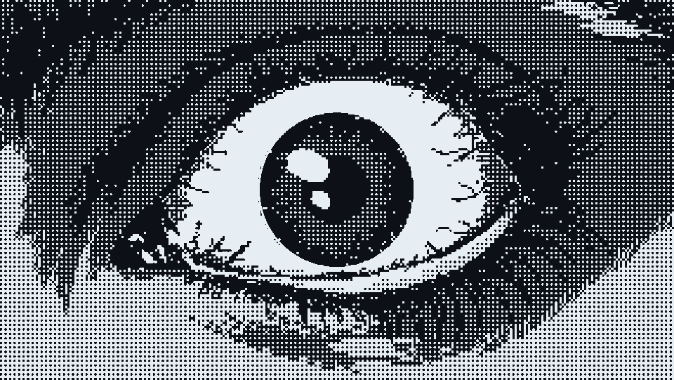
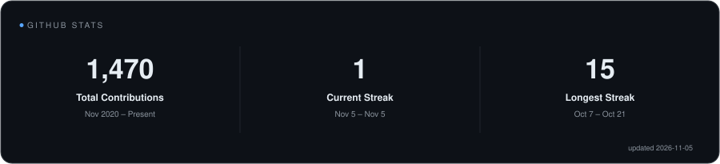
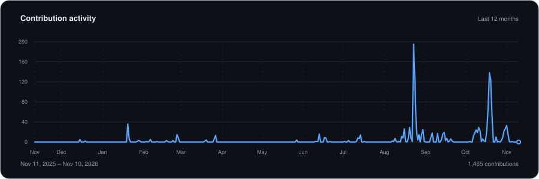

  

<h1 align="center">Hi 👋, I'm Tejas</h1>

<h3 align="center">Full-Stack Developer &amp; UI/UX Designer</h3>

  Building performant, design-driven digital experiences with clean architecture and a sharp eye for detail.

  <code>B.Tech CSE @ LPU</code> &nbsp;·&nbsp;
  <code>Google UX Design Certified</code> &nbsp;·&nbsp;
  <code>Design systems &amp; AI products</code>

---

## 🚀 About Me

<table>
<tr>
<td width="62%" valign="top">

I'm a **full-stack developer and UI/UX designer** pursuing B.Tech CSE at LPU. I care about the whole product: the data model, the API, the interaction, and the last 2 pixels of the interface.

I build with **React, TypeScript, Node.js, and MongoDB**, and I'm increasingly drawn to **AI-powered tools, developer experience, and design systems**. I'm Google UX Design certified and performance-first by default.

Right now I'm building:

- **[Sawn](https://github.com/Tejas-v-krishna/usesawn)** — an AI-powered code editor and development environment.
- **[Flowdesk](https://github.com/Tejas-v-krishna/flowdesk)** — a personal productivity OS for projects, tasks, notes, and analytics.
- **[Figma Design System Plugin](https://github.com/Tejas-v-krishna/figma-design-system-plugin)** — turns one brand color into tokens, styles, and 50 components.

My goal is simple: ship software that feels fast, looks intentional, and holds up when real people use it.

</td>
<td width="38%" align="center" valign="middle">
  
</td>
</tr>
</table>

---

## 🤝 Connect

  
  &nbsp;&nbsp;
  
  &nbsp;&nbsp;
  

---

## 💻 Tech Stack

  

---

## 📊 GitHub Stats

  

---

## 📈 Activity Graph

  

---

  <i>"Simplicity is prerequisite for reliability."</i> — Edsger W. Dijkstra

