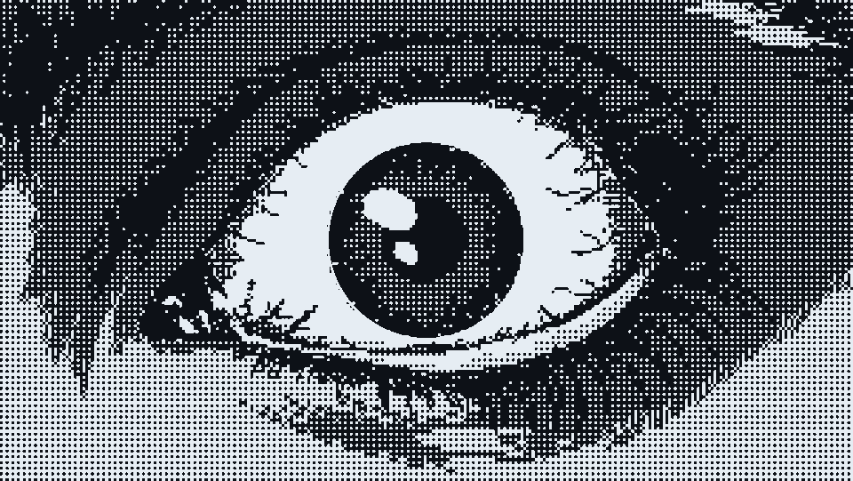
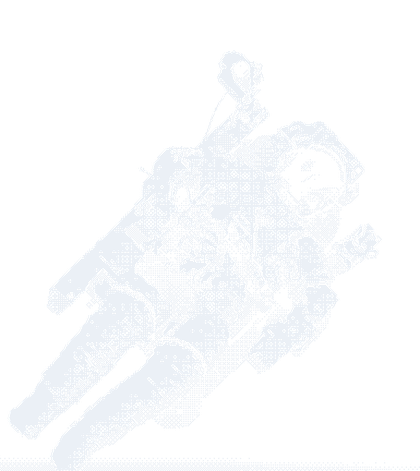
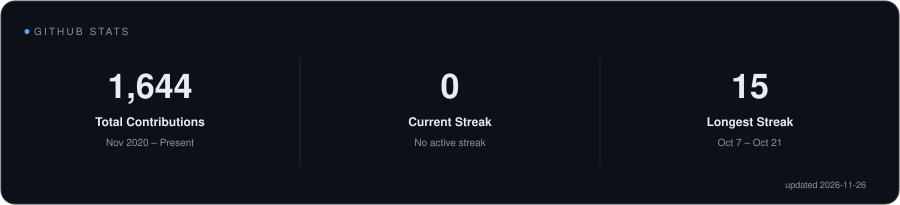
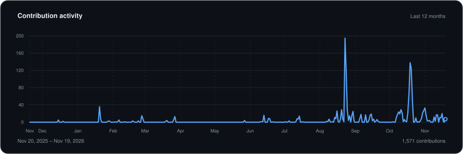

  

  <a href="mailto:tejaskrishna2018@gmail.com" title="Send Tejas a message">
    <picture>
      <source media="(max-width: 760px) and (prefers-color-scheme: dark)" srcset="assets/profile-card-mobile-dark.svg" />
      <source media="(max-width: 760px) and (prefers-color-scheme: light)" srcset="assets/profile-card-mobile-light.svg" />
      <source media="(prefers-color-scheme: dark)" srcset="assets/profile-card-dark.svg" />
      <source media="(prefers-color-scheme: light)" srcset="assets/profile-card-light.svg" />
      
    </picture>
  </a>

## About

I'm a **full-stack developer and UI/UX designer** pursuing B.Tech CSE at LPU. I care about the whole product: the data model, the API, the interaction, and the last 2 pixels of the interface.

I build with **React, TypeScript, Node.js, and MongoDB**, and I'm increasingly drawn to AI-powered tools, developer experience, and design systems. I'm Google UX Design certified and performance-first by default.

**Currently building**

- **[Sawn](https://github.com/Tejas-v-krishna/usesawn)** — an AI-powered code editor and development environment.
- **[Flowdesk](https://github.com/Tejas-v-krishna/flowdesk)** — a personal productivity OS for projects, tasks, notes, and analytics.
- **[Figma Design System Plugin](https://github.com/Tejas-v-krishna/figma-design-system-plugin)** — turns one brand color into tokens, styles, and 50 components.

  

## Stack

- **Frontend** — React · Next.js · TypeScript · JavaScript · Tailwind CSS · HTML · CSS
- **Backend** — Node.js · Express · PostgreSQL · MongoDB · Prisma
- **Design** — Figma · Design systems · Prototyping · Accessibility
- **Tooling** — Git · GitHub · Docker · AWS · Vercel · Firebase

## GitHub stats

  <picture>
    <source media="(max-width: 760px)" srcset="assets/stats-mobile.svg" />
    
  </picture>

## Activity

  <picture>
    <source media="(max-width: 760px)" srcset="assets/activity-mobile.svg" />
    
  </picture>

## Contact

  <a href="mailto:tejaskrishna2018@gmail.com">Email</a> &nbsp;·&nbsp;
  <a href="https://github.com/Tejas-v-krishna">GitHub</a> &nbsp;·&nbsp;
  <a href="https://www.linkedin.com/in/tejas-v-krishna/">LinkedIn</a>

> Simplicity is prerequisite for reliability.
>
> — Edsger W. Dijkstra
